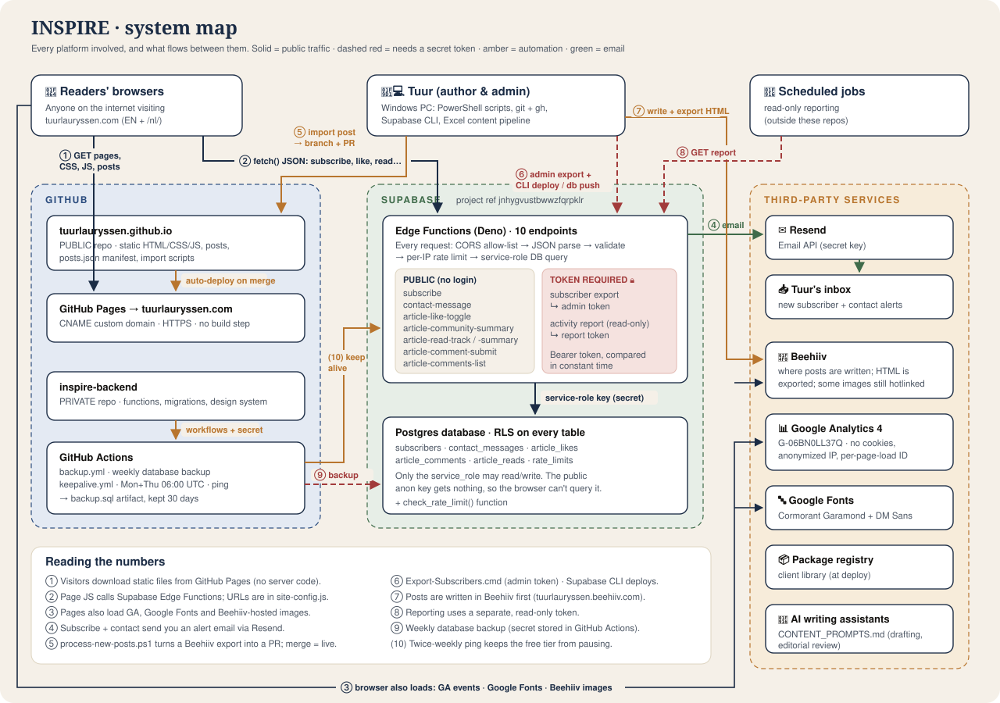

# INSPIRE architecture map

> How this website, its private backend and the outside services fit together.
> Pictures first, details after.
>
> *Last mapped: 2026-10-28, from `tuurlauryssen.github.io@14c61bd` and `inspire-backend@69e27df`.*

## The whole thing in five sentences

1. **This website is just files.** This repo holds plain HTML, CSS and JavaScript. GitHub Pages serves them at **tuurlauryssen.com**, and no server code runs here.
2. **Anything "live" goes through Supabase.** When a visitor subscribes, sends a message, likes a post or reads an article, the page's JavaScript calls a Supabase Edge Function from the private `inspire-backend` repo, which stores the data in Postgres.
3. **Email goes through Resend.** New subscribers and contact messages trigger an alert email to Tuur's inbox.
4. **Articles are written in Beehiiv and copied over.** `scripts/process-new-posts.cmd` turns a Beehiiv HTML export into a page here and opens a pull request. Merging it publishes the article.
5. **Analytics are cookie-free.** Google Analytics 4 runs with `storage: "none"`, anonymised IPs and a new random ID on every page load.

## Documents in this folder

| Document | What you'll learn | Main visuals |
|----------|-------------------|--------------|
| [The website](website.md) | Folder map, which scripts each page loads, what happens when someone opens an article, post cards, forms, analytics, EN/NL | Script-loading diagram, article sequence, read timeline |
| [Connections](connections.md) | Every platform and URL the site touches, how it's coupled to the backend, what breaks when something is down | Platform graph, coupling diagram, blast-radius table |
| [Content pipeline](content-pipeline.md) | From idea to live article, step by step | Pipeline figure, script internals, manifest flow |
| [Security (public summary)](security.md) | What's public on purpose, what's protected and how | Trust diagram, checklist |

**Backend docs.** The full backend architecture (all 10 endpoints, the data model, secrets and the detailed security review) lives in the **private** repo: [`inspire-backend/docs/architecture`](https://github.com/tuurlauryssen/inspire-backend/blob/main/docs/architecture/README.md). Only people with access to that repo can open the link.

## Colour code used in every diagram

- 🟦 **navy / blue** is public traffic and GitHub
- 🟩 **green** is Supabase or email
- 🟧 **amber** is automation and third parties
- 🟥 **red** is anything that needs a secret token (never in this repo)

## Glossary

| Term | Plain meaning |
|------|---------------|
| **GitHub Pages** | GitHub's free hosting for static files. It serves this repo from `main`. |
| **Supabase Edge Function** | A small server-side program on Supabase that answers one URL, like `…/functions/v1/subscribe`. |
| **`site-config.js`** | The one file that tells the site where those functions are. It contains public values only. |
| **CORS** | A browser rule. The backend only lets `tuurlauryssen.com` (and local dev) read its responses. |
| **Visitor token** | A random ID made on every article page load. The backend stores only its hash, and nothing is saved in the browser. |
| **Manifest** | `assets/data/posts.json` (+ `posts-data.js`): the list of posts the homepage and archive render. |
| **Beehiiv** | The newsletter platform where posts are written and sent. |
