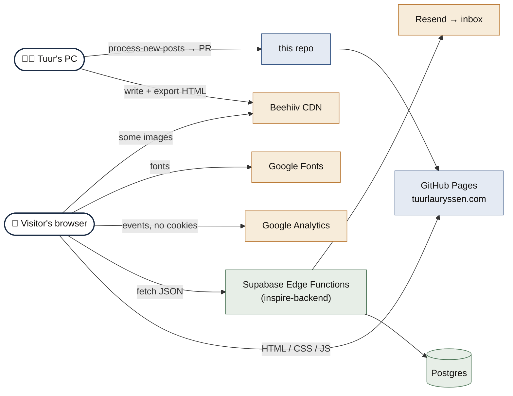
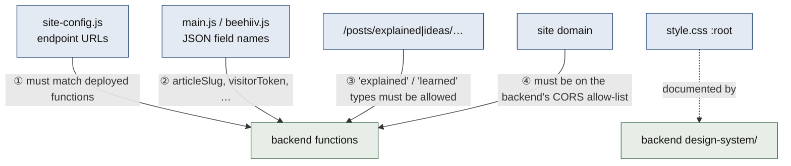

# Connections: platforms, URLs, couplings

[← back to the map](README.md)

## Platforms this site touches

| Platform | Role | Identifier (all public) |
|----------|------|-------------------------|
| **GitHub Pages** | Hosts this repo | `tuurlauryssen.com` (from `CNAME`) |
| **Supabase** | Backend API (Edge Functions) + database, in the private `inspire-backend` repo | Project ref `jnhygvustbwwzfqrpklr` |
| **Resend** | Sends alert emails (called by the backend, never by the site) | — |
| **Beehiiv** | Where newsletter editions are written; image CDN | `tuurlauryssen.beehiiv.com`, `media.beehiiv.com` |
| **Google Analytics 4** | Cookie-free analytics | `G-06BN0LL37Q` |
| **Google Fonts** | Cormorant Garamond + DM Sans | `fonts.googleapis.com` |
| **GitHub + `gh` CLI** | Used by the import script to push a branch and open a PR | — |

## Backend endpoints the site calls

All of them are in `assets/js/site-config.js`, under `https://jnhygvustbwwzfqrpklr.supabase.co/functions/v1/`:

| Config key | Function | Called from | When |
|------------|----------|-------------|------|
| `subscribeEndpoint` | `subscribe` | `main.js` → subscribe forms | form submit |
| `contactEndpoint` | `contact-message` | `main.js` → contact form, article "reply" form | form submit |
| `communitySummaryEndpoint` | `article-community-summary` | `main.js` (article page), `beehiiv.js` (each post card) | page load |
| `communityLikeEndpoint` | `article-like-toggle` | `main.js` 👍 button | click |
| `readTrackEndpoint` | `article-read-track` | `main.js` article page | on open + after 10 s active |
| `readSummaryEndpoint` | `article-read-summary` | `beehiiv.js` post cards | page load (one batch call) |
| `communityCommentEndpoint` | `article-comment-submit` | *not called; no comment UI yet* | — |
| `communityCommentsEndpoint` | `article-comments-list` | *not called; no comment UI yet* | — |

The backend also has two **token-protected admin endpoints** (subscriber export, weekly report). The site never calls them, and their tokens are never in this repo.

## How this repo is coupled to the backend

| Coupling | If it drifts… |
|----------|---------------|
| ① endpoint URLs | Forms show "Request failed"; counters quietly disappear |
| ② JSON field names | Backend answers 400 |
| ③ article types (renaming a section!) | Likes, reads and replies on that section are rejected. This happened once, when "interviews" was renamed to "explained". |
| ④ domain / CORS | The browser blocks every backend response. Changing the domain means updating the backend's allow-list too. |

## What breaks if something goes down

| If this is down… | Pages | Subscribe / contact | Likes / reads | Publishing |
|------------------|:-----:|:-------------------:|:-------------:|:----------:|
| GitHub Pages | ❌ | ❌ | ❌ | ⚠️ waits |
| Supabase | ✅ | ❌ error shown | ⚠️ counters hidden | ✅ |
| Resend | ✅ | ✅ still saved | ✅ | ✅ |
| Beehiiv | ⚠️ hotlinked images missing | ✅ | ✅ | ❌ |
| Google Analytics / Fonts | ✅ (no stats / fallback font) | ✅ | ✅ | ✅ |

The core reading experience depends only on GitHub Pages. Everything from Supabase is an extra layer on top, so the site still works when the backend is down.
