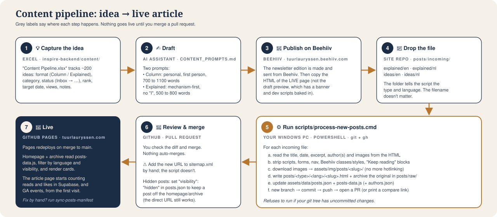
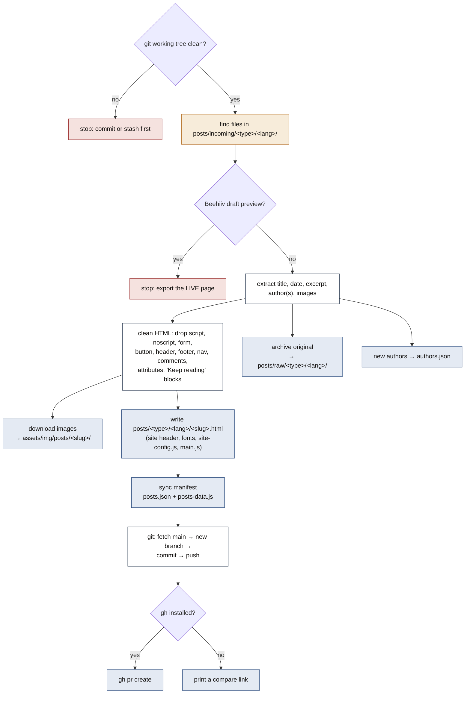
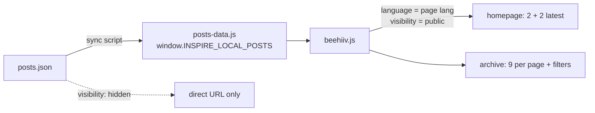

# Content pipeline: idea → live article

[← back to the map](README.md)

Step-by-step instructions are in [`POST_WORKFLOW.md`](../../POST_WORKFLOW.md), and the drafting prompts are in [`CONTENT_PROMPTS.md`](../../CONTENT_PROMPTS.md). This page shows how the pieces connect.

## Inside `process-new-posts.ps1`

## Folder → type → URL

| Drop folder | `type` in manifest | Published at | Badge on cards |
|-------------|-------------------|--------------|----------------|
| `posts/incoming/explained/en` | `explained` | `/posts/explained/en/<slug>.html` | Explained |
| `posts/incoming/explained/nl` | `explained` | `/posts/explained/nl/<slug>.html` | Uitgelegd |
| `posts/incoming/ideas/en` | `learned` | `/posts/ideas/en/<slug>.html` | Columns |
| `posts/incoming/ideas/nl` | `learned` | `/posts/ideas/nl/<slug>.html` | Columns |

> The folder is called `ideas`, the type is `learned` (from the old name "Things I Learned"), and the label shown on the site is "Columns". It's the same thing under three names. The backend only accepts the types `explained`, `learned` and the legacy `interview`.

## From manifest to homepage

After merging: add the new URL to `sitemap.xml` by hand, because the script doesn't do it.
