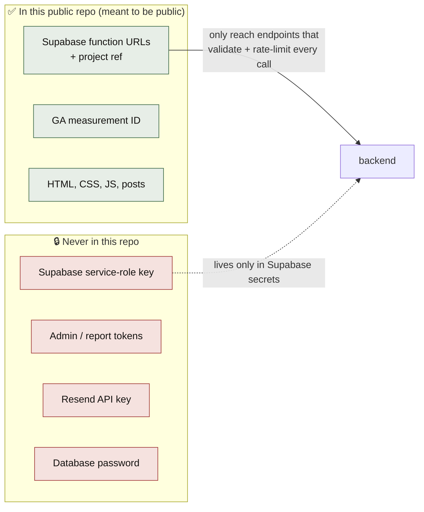

# Security: public summary

[← back to the map](README.md)

This repo is **public**, so this page only covers what's safe to publish. The full security review of the backend, with the secrets map and risk register, lives in the private `inspire-backend` repo.

## What's in this repo, and why it's fine

- The **function URLs** have to be public, because the browser calls them. They only do narrow, validated things (subscribe, send a message, like, count a read), and only the backend holds the database key.
- The **database** has Row Level Security on every table. The public Supabase key can't read or write anything.
- **No secret has ever been committed.** A scan of the full history (128 commits) found no keys, tokens or passwords. `.gitignore` also blocks `.env*` files.

## What the site does to protect visitors

| Protection | Where |
|------------|-------|
| No cookies at all. GA4 runs with `storage: "none"`, `anonymize_ip: true` and a new random ID per page load. | `assets/js/main.js` → `initializeAnalytics()` |
| Nothing stored in the browser for likes/reads. The visitor token lives in memory only, and the backend stores only its SHA-256 hash. | `main.js` → `getVisitorToken()` |
| Post titles, links and excerpts are HTML-escaped before rendering; counters use `textContent`. | `assets/js/beehiiv.js`, `main.js` |
| Imported Beehiiv HTML has `<script>`, forms, buttons and inline attributes stripped. | `scripts/process-new-posts.ps1` |
| External links open with `rel="noopener noreferrer"`. | `main.js` → `initExternalLinks()` |
| No public email address on the site, only the contact form. | homepage contact section |
| Every content change goes through a pull request you merge yourself. | import script |
| HTTPS on the custom domain via GitHub Pages. | Pages settings |

## Known limitations (low risk)

| Note | Why | Possible improvement |
|------|-----|----------------------|
| No Content-Security-Policy | GitHub Pages can't send custom headers, and the pages use inline scripts | Move the inline scripts into files, then add a `<meta http-equiv="Content-Security-Policy">` |
| `sandbox/` and `posts/raw/` are public and indexable | Everything in a public Pages repo is served | Add `<meta name="robots" content="noindex">` to sandbox pages, or remove them |
| Some images still load from Beehiiv's CDN | The first post predates the image-download step | Re-run it through the import script |
| GA4 still sends (anonymised) visitor data to Google | Analytics needs it | Make sure the site's privacy wording mentions Google Analytics |
| Like and read counts are approximate | Privacy-first design: a new token on every page load means repeat visits count again | Fine for a vanity metric |
