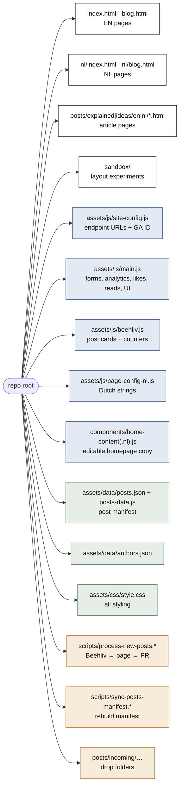
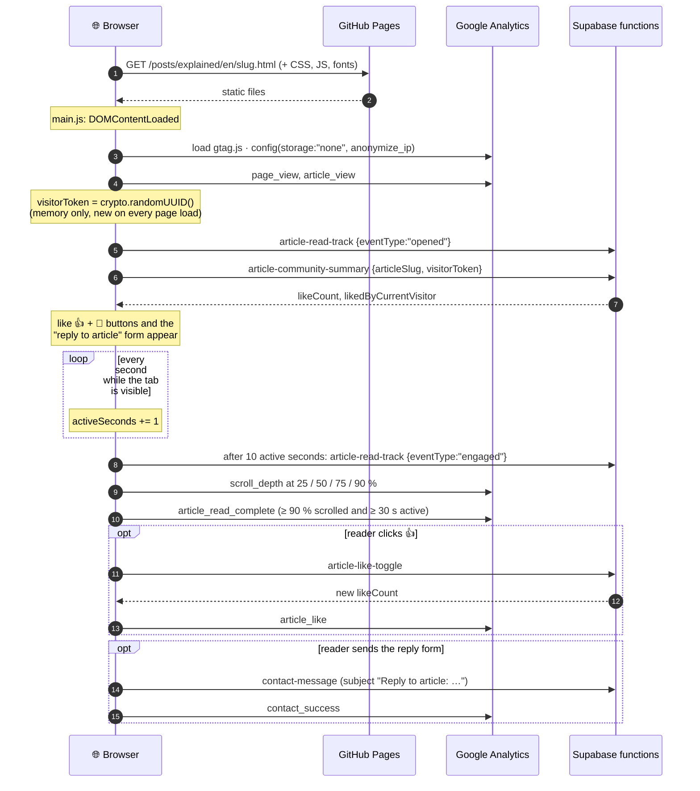
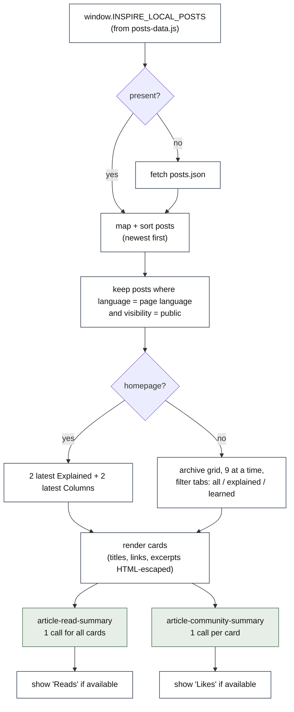
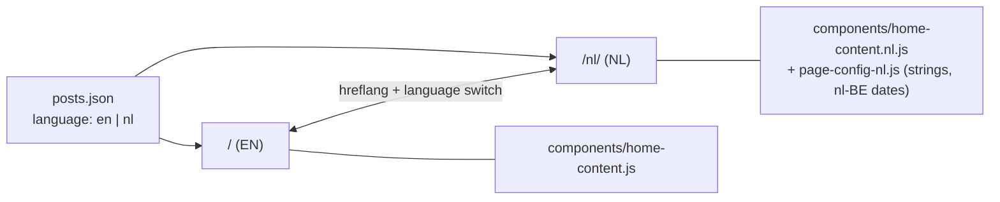

# The website (this repo)

[← back to the map](README.md)

The site is **100% static**: there's no build step, no framework and no server. GitHub Pages serves the files in the repo as they are. Everything dynamic happens in the visitor's browser, which calls the Supabase functions.

## 2.1 Folder map

## 2.2 Which scripts each page loads

Order matters. `site-config.js` must load before `main.js`, and `posts-data.js` before `beehiiv.js`.

```mermaid
flowchart TB
  classDef cfg fill:#E4EAF3,stroke:#2B4C7E,color:#141210
  classDef core fill:#FFFFFF,stroke:#1B2C45,stroke-width:2px,color:#141210
  classDef data fill:#E7EEE7,stroke:#3F6B4A,color:#141210

  subgraph Home["🏠 index.html / nl/index.html"]
    direction LR
    h0["home-content(.nl).js"]:::data --> h1["site-config.js"]:::cfg --> h1b["page-config-nl.js<br/>(NL only)"]:::cfg --> h2["main.js"]:::core --> h3["posts-data.js"]:::data --> h4["beehiiv.js"]:::core --> h5["inline: copy, hero logo<br/>canvas, rotating quotes"]:::core
  end
  subgraph Blog["🗂️ blog.html / nl/blog.html"]
    direction LR
    b1["site-config.js"]:::cfg --> b1b["page-config-nl.js<br/>(NL only)"]:::cfg --> b2["main.js"]:::core --> b3["posts-data.js"]:::data --> b4["beehiiv.js"]:::core --> b5["inline: quotes"]:::core
  end
  subgraph Article["📄 posts/…/slug.html"]
    direction LR
    a1["site-config.js"]:::cfg --> a2["main.js"]:::core
  end
```

## 2.3 What happens when someone opens an article

`main.js` waits for `DOMContentLoaded`, then wires everything up. On an **article page** that comes down to this:

### The "engaged read" timeline, visually

```mermaid
gantt
  title One article visit (seconds of active, visible-tab time)
  dateFormat ss
  axisFormat %Ss
  section Supabase
  "opened" row written         :milestone, 00, 0s
  "engaged" (≥10 s active)     :milestone, 10, 0s
  section Google Analytics
  page_view + article_view     :milestone, 00, 0s
  scroll_depth events          :active, 00, 30s
  article_read_complete (≥30 s and 90 % scroll) :milestone, 30, 0s
```

> **What "Reads" means on the post cards:** the number of **engaged** reads, meaning page loads where the tab was visible for at least 10 seconds.
> The visitor token is new on every page load, so one person reading twice counts twice. That's a deliberate privacy choice: nothing is stored in the browser. The same applies to likes.

## 2.4 Homepage & archive: how post cards are built

Counters start hidden. They only appear when the backend answers, so a backend outage just means no numbers.

## 2.5 Forms on the site

| Form | Where | Client-side checks | Sends to | Success message |
|------|-------|--------------------|----------|-----------------|
| **Subscribe** (`[data-subscribe-form]`) | Homepage + archive (EN + NL) | email pattern, ≤ 200 chars | `subscribe` with `{email, source:"website", language:<page lang>, metadata.page}` | "Subscription confirmed." / "You are on the list." |
| **Contact** (`[data-contact-form]`) | Homepage contact section (built by `main.js`) | name 2–100, email ≤ 200, message 10–5000 | `contact-message` with `source:"website-contact"` | "Your message is on its way." |
| **Reply to article** | Bottom of every article (same form, pre-filled subject + prompt) | same | `contact-message` | same |

The client-side checks only improve the experience. The backend checks everything again, and its limits are the ones that count (see the backend's [request flows](https://github.com/tuurlauryssen/inspire-backend/blob/main/docs/architecture/03-backend-and-flows.md), private repo).

## 2.6 Analytics: what Google receives

| Event | When | Extra parameters |
|-------|------|------------------|
| `page_view` | every page | `page_path`, `page_lang` |
| `article_view` | article pages | article slug/path/title/language/type |
| `scroll_depth` | 25/50/75/90 % | `percent_scrolled` |
| `article_read_complete` | ≥ 90 % scroll **and** ≥ 30 s active | `active_seconds` |
| `article_like` | 👍 clicked | `liked` |
| `subscribe_success`, `contact_success` | form sent | — |
| `archive_filter_selected` | archive tab clicked | `filter_name` |
| `outbound_click` | link to another domain clicked | `outbound_url` |

Privacy settings in `initializeAnalytics()`: `storage: "none"` (no cookies), `anonymize_ip: true`, and a `client_id` that's random on every page load. Google can't link visits together through cookies, and the site sets no cookies of its own.

## 2.7 Bilingual setup

- Each language has its own homepage and archive. Posts are filtered by their `language` field.
- `sitemap.xml` declares the EN/NL alternates with `hreflang`.
- Subscribers get `language` = the page's `<html lang>`, so you know which edition they signed up from.

## 2.8 Small things worth knowing

- **`components:loaded` listener** in `main.js` is left over from a removed `component-loader.js`, and nothing fires it any more. It's harmless dead code.
- **`sandbox/`** is a public copy of older layouts, reachable at `tuurlauryssen.com/sandbox/`. It's not blocked by `robots.txt` and has no `noindex`, so search engines may index it.
- **Hotlinked images.** The homepage hero image and the first article still load images from Beehiiv's CDN. Re-running that post through the import script would bring them local.
- **Static like/read numbers in `posts.json`** (`"likes": 32, "reads": "1.2k"`) come from Beehiiv at import time. The live counters on cards come from Supabase instead, so the two can differ.
